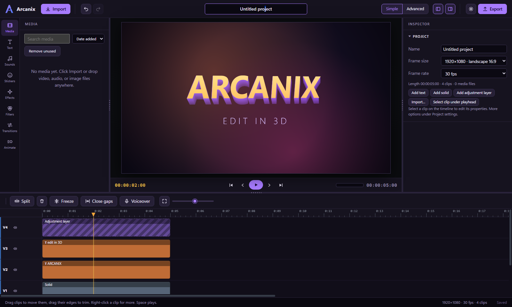

<p align="center">
  
</p>

<h1 align="center">Arcanix</h1>

<p align="center">
  A fast, offline video editor for Windows and Linux, with After Effects-style 3D layers, masks and 3D text.<br>
  Built with Rust (Tauri). The installer is about 1.3 MB. No account, no internet connection, nothing uploaded.
</p>

<p align="center">
  <a href="../../releases/latest"><b>⬇ Download the latest release</b></a>
</p>



## Download

Go to [**Releases**](../../releases/latest) and pick one:

**Windows**

| File | Size | What it is |
|---|---|---|
| `Arcanix-Setup.exe` | ~1.3 MB | Installer. Adds Start Menu and desktop shortcuts; uninstall from Windows Settings › Apps. |
| `Arcanix.exe` | ~3.4 MB | Portable version. One file, nothing to install. |

Windows may show **"Windows protected your PC"** because the app isn't code-signed. Click **More info → Run anyway**.
Requires Windows 10 or 11 (64-bit) with the Microsoft Edge WebView2 runtime, which comes with Windows 11 and up-to-date Windows 10. The installer never downloads anything.

**Linux** (64-bit, x86_64)

| File | What it is |
|---|---|
| `Arcanix-linux-x86_64.AppImage` | Runs on most distributions. Make it executable, then double-click it: `chmod +x Arcanix-linux-x86_64.AppImage` |
| `Arcanix-linux-amd64.deb` | For Debian, Ubuntu, Linux Mint, Pop!_OS: `sudo apt install ./Arcanix-linux-amd64.deb` |

The Linux version uses the system's WebKitGTK engine. Everything works the same, with these differences that depend on your WebKitGTK version:
- **Fast export** needs WebCodecs (WebKitGTK 2.46 or newer). Without it, export uses **Real-time** mode, which records the video while it plays.
- Some colour filters (brightness, blur and similar) need canvas filter support in WebKitGTK; on older versions they have no effect.
- Voiceover recording depends on the desktop's microphone permission.

The Linux files are built automatically by GitHub (see `.github/workflows/build.yml`) every time a release is published.

## Features

**Editing**
- Multi-track timeline for video, images, text and audio
- Split, trim, ripple, slip, nudge, duplicate, copy / cut / paste
- Freeze frame, close gaps, in / out points, markers
- Linked audio after detaching it from a video
- Keyframes with easing, hold, and custom speed curves
- **Graph editor**: drag keyframes and curve handles (Easy ease, Overshoot, custom bezier)
- Undo / redo for everything, plus autosave

**Compositing (After Effects-style)**
- **3D layers**: tilt, turn and push any clip in depth with real perspective, all keyframeable
- **Blend modes**: Multiply, Screen, Overlay, Add, Difference, Soft light and 11 more
- **Masks**: rectangle or ellipse, with feather, rounded corners and invert; keyframeable position and size
- **Adjustment layers**: colour and effects that apply to everything below them
- Effects: drop shadow, stroke, RGB split, wave warp, light leak, gradient overlay, vignette, tint, grain, glow, pixelate, shake, motion blur
- Colour grading and chroma key (green screen) with an eyedropper
- **Per-colour saturation**: turn reds, oranges, yellows, greens, aquas, blues, purples and magentas up or down separately, plus filters built on it (Red pop, Blue skies, Autumn, Cyberpunk, Muted earth)
- Fit, fill, stretch, or fit with a **blurred background** (the vertical-video look)
- **19 transitions**: fade, cross-dissolve, push, wipe, clock wipe, slide, whip pan, zoom, zoom out, blur, iris, spin, spin blur, bounce, drop, roll, split, flash, glitch

**Text**
- **3D extruded text**: depth, direction, slant, side colour and shading, with presets (Retro, Gold block, Neon slab, Ice)
- Any installed font, weight 100–900, ALL CAPS, letter spacing, gradients, outlines, backgrounds
- Word-by-word and line animations, typewriter, text presets

**Audio**
- Volume, fades, ducking, normalize, clean voice, per-track gain
- Speed changes that keep the pitch
- Built-in sound effects and music beds (generated in code, no samples)
- Voiceover recording from your microphone

**Export**
- Fast MP4 export (H.264 + AAC), or real-time recording
- Any size from 360p to 4K, and 15 to 60 fps
- Export the whole video or just a range
- Audio-only export (WAV or M4A), and PNG stills

**Look and feel**
- 6 themes: Arcane, Runeglow, Ember Sigil, Astral, Void, Verdant Hex
- Resizable panels: drag any edge, double-click to reset, or use the arrow keys
- Simple mode for everyday editing, Advanced mode for everything else

## Shortcuts

| Key | Action |
|---|---|
| `Space` | Play / pause |
| `S` or `Ctrl+K` | Split at the playhead |
| `Ctrl+Z` / `Ctrl+Y` | Undo / redo |
| `Ctrl+C` / `X` / `V` | Copy / cut / paste |
| `Ctrl+D` | Duplicate |
| `Ctrl+S` | Save a project file |
| `Delete` | Delete the selected clip |
| `F` | Freeze frame |
| `←` / `→` | Step one frame |
| `F11` | Full screen |

The full list is under **Settings (gear icon) › Keyboard shortcuts**.

## Privacy

Arcanix never connects to the internet. There is no telemetry, no auto-updater and no account. The only permission it asks for is the microphone, and only when you record a voiceover.

## Building from source

You need:
- [Node.js](https://nodejs.org) 18 or newer
- [Rust](https://rustup.rs) (stable), with the WebAssembly target: `rustup target add wasm32-unknown-unknown`
- On Windows: Visual Studio Build Tools with the "Desktop development with C++" workload
- On Linux (Debian / Ubuntu): `sudo apt install libwebkit2gtk-4.1-dev libgtk-3-dev libayatana-appindicator3-dev librsvg2-dev patchelf libssl-dev`

```bash
npm install
```

```bash
npm run build
```

That compiles the Rust image / audio core to WebAssembly (`rustcore.js`), then builds the app and its installer:

- `src-tauri/target/release/arcanix.exe` (the portable app)
- `src-tauri/target/release/bundle/nsis/Arcanix_2.0.0_x64-setup.exe` (the installer)

On Linux, run `npm run build:linux` instead. It makes `src-tauri/target/release/bundle/appimage/*.AppImage` and `bundle/deb/*.deb`.

`npm run dev` runs the app straight from the source without making an installer.

> If the build fails because a path is too long, move the project to a short path such as `C:\arcanix`, or set `CARGO_TARGET_DIR` to a short folder.

The older Electron shell still works for development: `npm start`.

### Project layout

| Path | Purpose |
|---|---|
| `src-tauri/` | The Rust desktop app (window, Save dialogs, chunked file writing, self-test runner) |
| `core/` | Rust image / audio kernels compiled to WebAssembly (colour grade + chroma key, waveforms) |
| `index.html`, `style.css` | The editor's layout, styling and themes |
| `app.js` | The editor: timeline, rendering, inspector, export |
| `layers.js` | 3D layers and 3D text (WebGL), blend modes, masks, adjustment layers, extra effects, graph editor |
| `fastexport.js` | Fast MP4 export (WebCodecs + MP4 writer) |
| `sounds.js` | Built-in sound effects and music |
| `rustcore.js` | Generated: the WebAssembly core plus its glue |
| `shell-tauri.js` | Title bar, window buttons and file saving in the Rust app |
| `selftest.js` | Automated self-test |
| `build/` | Icon generator, logo files, web staging and WebAssembly build scripts |
| `main.js`, `preload.js` | Electron shell (development / legacy) |

### Self-test

Set `FRAMEWRIGHT_SELFTEST` to a file path and start the app. It imports test media, edits, renders 3D layers, masks and effects, exports, reads the export back, writes the results to that file as JSON and quits. `"ok": true` means everything passed.

## License

[MIT](LICENSE)
